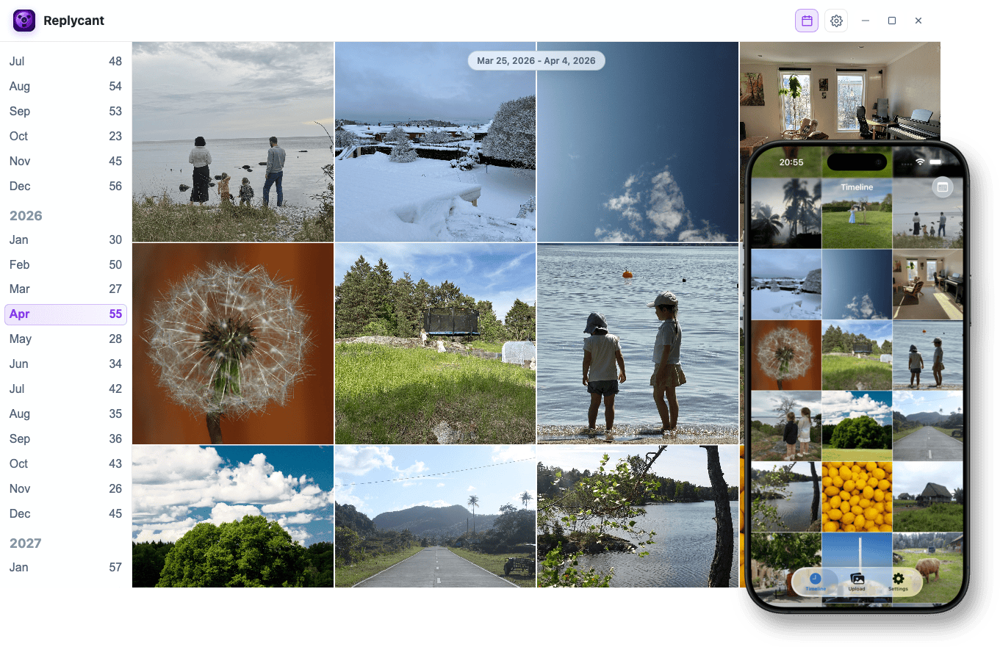

# Replycant

A self-hosted photo library focused on privacy, data durability, and ease of use.

Replycant is a simple photo library based on proven technologies. It uses Git with LFS for storage of metadata and binary objects, mTLS for client authentication, Age for key encryption and AES-GCM for metadata/object encryption.

## Why Replycant

- **[Private by design](#private-by-design)** — photos and metadata are
  encrypted before upload; the server stores only ciphertext
- **[Based on proven technologies](#based-on-proven-technologies)** — uses Git
  and Git LFS, with metadata structured as YAML
- **[Zero-config hosting](#zero-config-hosting)** — start with Docker Compose
  and connect by scanning a QR code
- **[Easy to back up](#easy-to-back-up)** — copy or mirror your complete
  library using standard Git and filesystem tools
- **[Device-centric auth](#device-centric-auth)** — each device authenticates
  with its own mTLS certificate; no passwords or central user database

Part of Replycant is also an open source iOS app which is published on the app store.



## Getting started

**1. Start the server**

Download [`docker-compose.yaml`](https://github.com/mr-andreas/replycant/releases/latest/download/docker-compose.yaml)
from the latest GitHub Release, and then start it:

```bash
curl -fsSL -o docker-compose.yaml \
  https://github.com/mr-andreas/replycant/releases/latest/download/docker-compose.yaml
docker compose up
```

This will use the directory where you have placed docker-compose.yaml for both metadata and binary storage, which is usually fine. If you wish to select another directory or change the published ports, create a `.env`, then bring the stack up:

```bash
cat > .env << EOF
REPLYCANT_DATA_DIR=/var/lib/replycant/data
REPLYCANT_LFS_DIR=/var/lib/replycant/lfs
REPLYCANT_CA_PORT=8080
EOF
```

The first-device join page listens on port `8080` by default; set
`REPLYCANT_CA_PORT` if that port is already in use. The Git server is not
published on the host at all: devices reach it over the library's private
network, which works the same at home and away, so there is no hostname
or Git port to configure.

**2. Install the iOS client**

[iOS app on the App Store](https://apps.apple.com/se/app/replycant/id6760653798)

**3. Link a device**

Using your computer, open the URL that you host the server on. Usually, this is http://localhost:8080 (or `http://localhost:$REPLYCANT_CA_PORT` if you changed the CA port). Start the iOS app and scan the QR code.

If the server has no browser, open `http://<server>:8080` from another
computer on your network instead. The page stops handing out join codes
once the first device has joined, and later devices are paired from that
one. To keep the page reachable only from the server itself, add
`REPLYCANT_CA_BIND=127.0.0.1` to `.env`.

## How Replycant works

### Private by design

Replycant encrypts photos, videos, and metadata on the client before uploading
them. The server stores only opaque ciphertext, so compromising the server is
not enough to expose your library. Only authorized devices hold the keys needed
to decrypt it.

### Based on proven technologies

Replycant builds on Git for versioned metadata and Git LFS for photos and
videos. Metadata is structured as YAML manifests, giving the library an
inspectable data model and a complete history instead of tying it to an opaque
hosted database.

### Zero-config hosting

On a typical Linux host, download the Docker Compose file and run
`docker compose up`. Replycant supplies sensible defaults for storage, ports,
and local-network discovery. Open the discovery page and scan its QR code to
connect the iOS app.

### Easy to back up

The Git repository can be copied, moved, or mirrored with established tools.
Git records the metadata history, while Git LFS storage holds encrypted media.
Backing up both gives you an independent copy of the complete library. Want an
extra backup somewhere? Simply create one using `git-replycant clone` and do
regular `git pull` to receive updates.

### Device-centric auth

Each device generates its own key pair and authenticates with an mTLS client
certificate. Private keys remain on the device, while authorized public keys
are committed to the library repository, making access control auditable
through Git history. New devices are authorized by an existing device using QR
codes—without passwords, user accounts, or a central identity database.

## Policies and support

- [Privacy policy](./PRIVACY.md)
- [Support](./SUPPORT.md)
