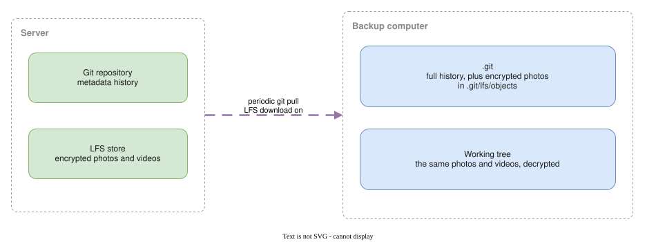

# Back up your library

On the backup computer, install the tools from [Clone your library](./clone-your-library.md), then clone with the photos included:

```bash
$ git-replycant clone backup
Generated new local identity in /home/you/backup/.git/replycant
Open http://127.0.0.1:54321 to view the pairing QR code.
Waiting for a paired device to approve this one...
Joined the tailnet. Waiting for repository authorization...
Authorization confirmed. Proceeding with clone.
From replycant::https://gitd.replycant.internal:8443
 * [new branch]      main       -> origin/main
...
Clone complete and filters configured in /home/you/backup
```

Approve the QR code the same way: **Settings**, **Link a New Device**.

```bash
$ git pull --ff-only
Updating a1b2c3d..e4f5a6b
Fast-forward
 ...
```

Run that on a schedule:

```bash
0 * * * * cd /path/to/backup && git pull --ff-only
```



The working tree holds the photos decrypted, so keep the clone on an encrypted disk. The copy takes about twice the size of the library.
