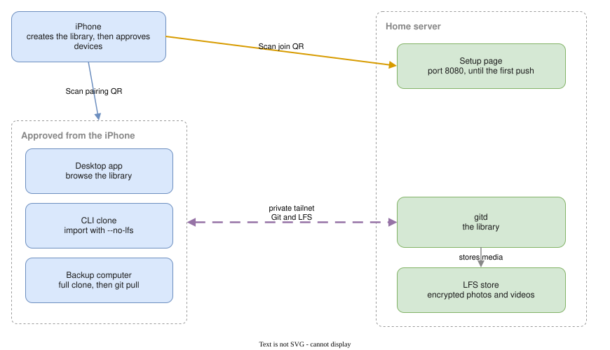

# Getting started

These pages take you from an empty machine to a library you can browse, fill from a folder of photos, and keep a second copy of.

The iPhone is the only app that can create a library. Every later device, including the desktop app, a command-line clone, and a backup computer, is approved by scanning a QR code on that iPhone. After that, each device syncs with the server over the library's private network. Nothing on your router has to be forwarded.

## Steps

1. [Start a server and link your apps](./start-a-server.md). Bring the server up with Docker Compose, create the library from the iPhone, and connect the desktop app.
2. [Clone your library](./clone-your-library.md). Pair a computer into the library with `git-replycant`.
3. [Import photos and videos](./import-media.md). Load an existing folder of media into that clone.
4. [Back up your library](./back-up-your-library.md). Keep a full copy on another computer with `git-replycant clone`, refreshed by a periodic `git pull`.

Steps 3 and 4 both start from the clone in step 2. Importing wants a clone without media downloads. A backup wants a clone that downloads every photo.
