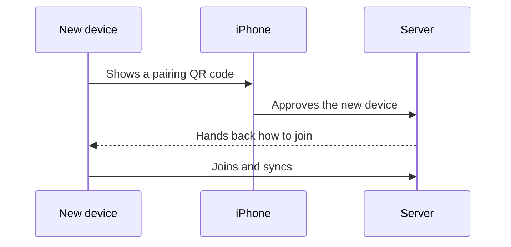

# Start a server and link your apps

The server holds the library. The iPhone creates it, and every other app joins by being approved from that iPhone.

## Start the server

Install Docker, then download the Compose file from the latest GitHub Release and start it:

```bash
curl -fsSL -o docker-compose.yaml \
  https://github.com/mr-andreas/replycant/releases/latest/download/docker-compose.yaml
docker compose up
```

The directory you run this from is where the library is stored. To put the data somewhere else, or to move the setup page off port 8080, create a `.env` next to the Compose file before starting:

```bash
cat > .env << EOF
REPLYCANT_DATA_DIR=/var/lib/replycant/data
REPLYCANT_LFS_DIR=/var/lib/replycant/lfs
REPLYCANT_CA_PORT=8080
EOF
```

`REPLYCANT_DATA_DIR` holds the repository and the server's own state. `REPLYCANT_LFS_DIR` holds the encrypted photos and videos, which is the part that grows with the library. `REPLYCANT_CA_PORT` is the port of the first-device setup page.

No router ports need to be forwarded. Devices reach the library over a private network that works the same at home and away. The setup page on port 8080 is the only page published on the machine, and it stops handing out join codes once the library exists. After that it answers `410 Gone`.

## Create the library

Install the [iOS app](https://apps.apple.com/se/app/replycant/id6760653798). It is the only client that can create a library.

On the server machine, open `http://localhost:8080` (or `http://localhost:<REPLYCANT_CA_PORT>` if you changed the port). A headless server has no browser of its own: open `http://<server>:8080` from another computer on the same network. The page is available on every interface so that works. Add `REPLYCANT_CA_BIND=127.0.0.1` to `.env` when you want the page reachable only on the server itself.

In the app, tap **Create a new library** and scan the QR code on that page. The phone joins the library's network and pushes the first commit. From then on, new devices are approved from this phone.

[Device onboarding](../gitdb/device-onboarding.md) and [connectivity](../gitdb/connectivity.md) describe what that first join exchanges and how the private network is built.

## Approve a new device

The desktop app, a [command-line clone](./clone-your-library.md), and a [backup computer](./back-up-your-library.md) all join the same way. The new device shows a QR code, and the iPhone approves it:

1. On the iPhone, open **Settings**, then **Link a New Device**, then **Scan QR Code**.
2. Scan the QR code shown by the new device.
3. The new device joins the library and starts syncing on its own.



The QR code is an approval request, so it stays on the new device's own screen. Scan it with the phone's camera while you are in front of that screen.

## Link the desktop app

Download the desktop app for your system from the [latest GitHub Release](https://github.com/mr-andreas/replycant/releases/latest): a `.dmg` on macOS, an `.AppImage` or `.deb` on Linux, or the Windows installer.

On first launch the app asks for a device name. That name is stored with this computer's key, so pick one you will recognize later, such as `kitchen-mac`. When the operating system has no keyring to protect the key, the app also asks for a password used only to encrypt the key on disk.

Click **Generate keypair**. The app shows a QR code. Approve it from the iPhone as described in [Approve a new device](#approve-a-new-device). The app then downloads the library and opens the timeline.

Use the installed desktop app, which is what connects to the library's network.
