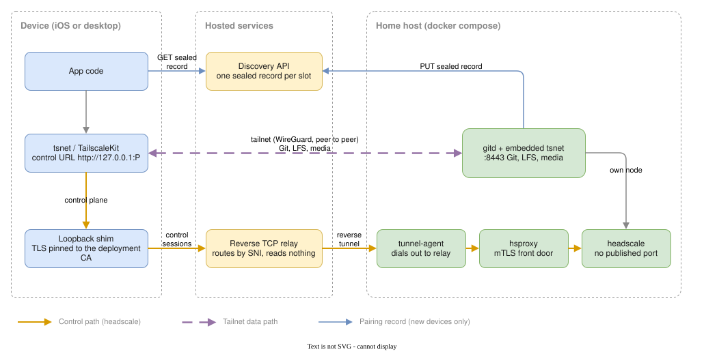
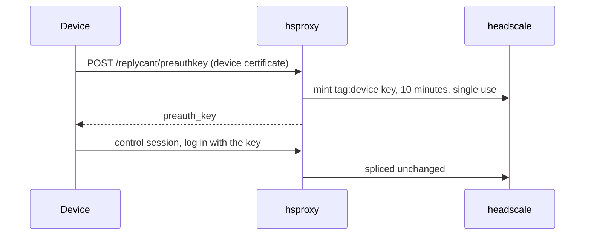

# Connectivity (Tailscale and headscale)

Devices reach gitd over a private tailnet rather than over a published port on
the user's router. The server hosts its own tailnet control plane (headscale)
next to gitd, and each device joins that tailnet before it speaks Git or LFS.

This exists because the previous model asked every user to make a home server
reachable from the internet. That means port forwarding, dynamic DNS, and a
publicly exposed TLS listener — a setup step most people cannot complete and a
permanent attack surface for those who can.

## Topology



Two paths matter and they are deliberately separate:

- **Control path.** Joining the tailnet requires talking to headscale. The
  first control session of each app launch goes through the hosted relay,
  because a device cannot route to peers until its node is up. After that the
  device's loopback shim prefers gitd's in-tailnet control relay (a raw TCP
  splice to hsproxy) and falls back to the hosted relay if that path fails.
- **Data path.** Git, LFS, decryptd, and transcoded all travel inside the
  tailnet, peer to peer. They never touch the relay.

## Joining a new repository

A new repository has no device keys, and the only tailnet member is gitd
itself. `headscale-init` creates the `replycant` user and an API key. gitd
uses that API key to mint its own key, tagged `tag:server`, each time it
starts and whenever headscale forgets it, and joins headscale over the compose network
(`http://headscale:8080`). That join does not cross the hosted relay.

The first device gets its trust anchor from the CA page on port 8080 of the
machine running gitd. That listener is never routed through the hosted relay
or the discovery API, so the CA and the one-time pre-auth key never pass
through them. Every request to the page mints a fresh key: single-use, valid
for 10 minutes. The QR shape is in
[Device Onboarding](./device-onboarding.md#server-configuration-qr).

The page listens on every interface by default, because a headless server has
no browser to open it locally. `REPLYCANT_CA_BIND=127.0.0.1` keeps it on the
host. LAN exposure is acceptable because the page mints keys only while the
repository has no branch. After the first push it
answers `410 Gone`, and later devices pair through an existing device. A
LAN host that pushes first only locks the operator out of an empty library,
which the operator sees and fixes by wiping it. A host that joins without
pushing is removed at the first push (see
[headscale holds only a cache](#headscale-holds-only-a-cache)).

The device pins the CA before it can join, and it joins before it can
push. `gitd.replycant.internal` does not resolve until the node is up.

1. Pin the CA and remember gitd as `https://gitd.replycant.internal:8443`.
2. Start the loopback shim and point the Tailscale client at
   `http://127.0.0.1:P`.
3. The shim dials the tunnel hostname. This is the first control session,
   so it can only go through the hosted relay: the node has no route to
   gitd yet.
4. `tunnel-agent` splices the stream to `hsproxy`. The repository has no
   branches, so `hsproxy` allows the device certificate even though it is
   not in `pubkeys/` yet. That exemption is the only way a first device
   can join, because the key cannot be committed until gitd is reachable.
5. `hsproxy` splices the authorized session to headscale, and the device
   joins with the key from the CA page. This is the only key hsproxy does
   not mint itself: while the repository is empty, it refuses key requests.
6. The device pushes its public key. gitd accepts the push because the
   repository is empty. That push closes the window: the next control
   session and the next Git request both require a key in `pubkeys/`.


## Later devices and later launches

A later device cannot open the CA page. It is not on the host, and gitd
publishes nothing it could dial. An already-paired device fetches a sealed
record for it. The record, the two encryption layers, and both delivery
channels — the discovery API, or a second QR when the operator publishes
headscale themselves — are in
[Tailnet Pairing](./device-onboarding.md#tailnet-pairing).

The record carries no tailnet key. The authorizing device commits the new
device's public key before it asks gitd to publish the record, so the new
device is already in `pubkeys/` and mints its own key through hsproxy. See
[headscale holds only a cache](#headscale-holds-only-a-cache).

Joining is part of every launch. A userspace node only runs while the app
does. On a normal launch the node logs in again with the state it saved on
its first successful join. A join that never succeeds does not save that
state, so a record that cannot be used does not leave the app retrying a
tailnet it never reached.

On iOS the same rebuild happens when the app returns from a long time in
the background. The node's status can keep reading as running across a
suspend, because that read does not use the local proxy the system may
have reclaimed, so a wake after that long does not trust the existing
node. A quick switch to another app leaves it running.

Each launch still opens its first control session through the hosted
relay. The shim cannot prefer the in-tailnet path until the node is up,
and the node cannot come up without a control session. Once the node is
running, later control sessions dial `gitd.replycant.internal:8444`, and
gitd splices that listener to the same `hsproxy`. The shim gives this path
two seconds, then falls back to the relay, so a peer that is offline does
not hang the control connection.

Git, LFS, and media take neither control path. They are tailnet
connections to `gitd.replycant.internal:8443`.

## The pieces

| Component | Where it runs | Role |
|-----------|---------------|------|
| headscale | home host, no published port | Tailnet control plane |
| hsproxy | home host, the only externally reachable service | Terminates TLS for headscale and authorizes the device |
| tunnel-agent | home host | Holds an outbound connection to the relay so no router port is needed |
| Reverse TCP relay | hosted, one process per shard | Accepts device connections on the public wildcard hostname and splices them to the agent |
| Discovery API | hosted | Holds one short-lived sealed record per slot |
| tsnet in gitd | home host | Puts gitd on the tailnet instead of on a host port |
| tsnet / TailscaleKit in clients | device | Puts the app on the tailnet |
| `git-remote-replycant` | CLI | Starts one tailnet agent per repository and sends git, LFS, and the importer through its loopback proxy |
| Loopback shim | device | Adds pinned TLS and the device certificate to headscale traffic |

### hsproxy

headscale has no client-certificate support and no configuration for a private
CA, so it cannot be the thing that authenticates devices. `hsproxy` sits in
front of it: it terminates TLS with a certificate from the deployment CA,
requires a client certificate, and authorizes the presented public key against
the repository's `pubkeys/` directory — the same authorizer gitd uses. Removing
a `.pub` file therefore revokes tailnet access and Git access at once.

`hsproxy` splices raw bytes rather than proxying HTTP. Tailscale's control
protocol upgrades a `POST` into a long-lived bidirectional stream, which no
HTTP-aware proxy layer survives. The one exception is
`POST /replycant/preauthkey`. hsproxy reads the request line of each
authorized connection, answers that request itself with a fresh `tag:device`
key, and splices every other request to headscale unchanged.

Once a device is on the tailnet, later control sessions go to gitd's second
tsnet listener (`:8444`), which splices to this same `hsproxy`. The
certificate therefore carries both the tunnel hostname and
`gitd.replycant.internal`, so either path verifies.

hsproxy sends the deployment CA after its leaf. A phone restoring from a
recovery key has only the CA's hash and no other way to fetch the CA: the CA
page is local to the server and closed once the library exists, and gitd is
reachable only over the tailnet. The phone
uses the CA in the chain only if its hash matches the recovery key. Sending
the CA adds no trust for anyone else, because every other client anchors to
the CA it was onboarded with.

### Who can talk to whom

The tailnet exists so devices can reach this household's server, not so they
can reach each other. headscale loads a file-mode policy that grants
`tag:device` access to `tag:server` on the Git and control ports only. There
is no device-to-device rule and no server-to-device rule, so a compromised
phone cannot enumerate or attack the rest of the household. gitd's own node
is tagged `tag:server` at mint time; every paired device is tagged
`tag:device`.

### headscale holds only a cache

Every node that git authorizes can ask for a fresh key, so nothing in
headscale's database has to be kept. An operator can delete `headscale/lib`
and run `docker compose up`, and every device comes back without being
paired again.

The same property lets gitd drop device nodes at the first push. Any node
that joined while the repository was empty did so without a key in
`pubkeys/`, so it is removed, unless gitd has just seen it authenticate with
a key the push authorized. That exception is what keeps the device that
created the library connected through its first sync.



- **Devices** mint a single-use `tag:device` key, valid for 10 minutes,
  through their loopback shim, so the request carries the pinned CA and the
  device certificate. hsproxy checks that certificate against `pubkeys/`
  before minting.
- **gitd** mints its own `tag:server` key over headscale's API.
- **First login.** A node that has never logged in gets its key before its
  tailnet node starts. gitd mints one on every start; a device mints one
  only when it has no saved login. Handing a key to a node already waiting
  in `NeedsLogin` does not reliably make it register.
- **Noticing.** A node starting from saved state that headscale does not
  know lands in `NeedsLogin`, and so does a running node whose key gitd
  expires. A running node that a wiped headscale forgot never changes
  state: it keeps reporting `Running` while its map polls fail with
  `404 node not found`. Clients watch for both, then mint a key and log the
  same node in again. They wait at least 30 seconds between mints.
- **Durable state.** Only headscale's noise key has to survive. It is the
  control plane's identity and every node pins it, so it lives in
  `headscale/noise`, outside the database directory. `headscale-init`
  replaces the API key when the wiped database no longer lists it, and gitd
  and hsproxy re-read that key file on every call.

Revocation runs the other way. headscale cannot record which key a node
belongs to, so gitd learns it: every request reaches gitd over its tailnet
listener, and gitd binds the calling node's machine key to the fingerprint
of the key the request authenticated with. gitd records the `pubkeys/` set
it last reconciled, and compares it with `main` at startup and after every
successful push. If any key was removed, it expires every `tag:device` node
that is not bound to a key still in `pubkeys/`. That is the revoked
device's node, plus any node gitd has not seen yet. Expiry, unlike
deletion, reaches a device that is online at that moment. An authorized
device whose node was expired notices and mints its way back in. The
revoked one is refused at hsproxy, and its node stays listed as expired.
If gitd loses its state file, nothing is bound, and the next reconcile
expires every device node once.

### The loopback shim

Neither `tsnet` nor `TailscaleKit` lets a caller install a private trust root or
a client certificate for the control URL. So the client points its control URL
at `http://127.0.0.1:P`, where a small local listener re-establishes the
connection to `hsproxy` over TLS with the deployment CA pinned and the device's
identity presented.

The plaintext hop never leaves the device. The listener binds to loopback only,
and Tailscale's control protocol is Noise-encrypted end to end regardless, so
the outer TLS is an authorization gate and defence in depth rather than the only
protection.

### Reverse TCP relay

The relay lets a home server be reachable without a forwarded port.
`tunnel-agent` dials out to the relay's registration listener presenting the
`hsproxy` leaf and the deployment CA, and the relay accepts the registration
only if the SHA-256 of the presented chain root matches the hostname label being
claimed. Possession of the CA key is the whole credential; there is no shared
secret to distribute.

The registration listener presents a self-signed certificate that is not
issued for any shard hostname. Agents pin that certificate rather than
checking `sNN.tunnel.replycant.com` against the public PKI; the pin is what
stops a random TLS endpoint from collecting registrations. The pin is built
into the `tunnel-agent` binary, so rotating it means shipping a new image.

Device traffic arrives on a separate listener. The relay peeks the TLS
ClientHello, reads the SNI, rejects anything that is not a handshake or whose
SNI has no live registration, and then copies bytes into a multiplexed stream to
the agent.

### Discovery API

A device that has never paired has no trust anchor: it does not know the CA, so
nothing it downloads can be checked against a signature it already trusts. The
discovery API therefore stores a record that is sealed twice, addressed by a
slot derived from a secret shown only in the pairing QR code. See
[Device Onboarding](./device-onboarding.md#tailnet-pairing) for the flow and
[the pairing record](#the-pairing-record) below for the format.

## What the hosted services can and cannot see

This is the part worth being precise about, because "we host a relay" sounds
like "we can read your traffic".

| Service | Sees | Does not see |
|---------|------|--------------|
| Reverse TCP relay | Ciphertext, the SNI hostname, connection timing and volume, client IP addresses | Anything inside the TLS session. It holds no key for it: TLS terminates at `hsproxy` on the user's own host |
| Discovery API | An opaque blob and the slot it was published under | The blob contents. The inner layer is encrypted to the device's age key and the outer layer is an AEAD under a key derived from the QR secret, neither of which the API ever receives |
| Tailscale DERP | WireGuard ciphertext, peer public keys, traffic volume | Packet contents |

The relay's SNI hostname is `{ca-label}.s{NN}.tunnel.replycant.com`. The first
label is a truncated hash of the deployment CA and identifies the deployment
without carrying a user identity. The second label is a shard slot taken from
the next byte of the same digest, modulo a permanently fixed 64. Registrations
live in one relay process's memory, so the fleet is sharded by hostname rather
than by shared state. Growing the fleet repoints DNS for some slots and never
changes a deployment's hostname, so no certificate needs reissuing and no
stored `headscale_url` goes stale.

Every reader of the CA fingerprint — the relay's SNI check, and both clients'
pairing-record verification — takes only the leftmost label, so the shard
component changes none of them.

### DERP

Peer-to-peer is the normal case: two devices on the same LAN connect directly,
and NAT traversal handles most of the rest. When direct connection fails,
Tailscale relays through its public DERP mesh
(`https://controlplane.tailscale.com/derpmap/default`).

That means media bytes can pass through infrastructure operated by Tailscale.
They are WireGuard-encrypted end to end, so Tailscale sees ciphertext, peer
public keys, and volume — not content. Replycant's own encryption sits inside
that, so DERP-relayed LFS objects are encrypted twice over.

The embedded DERP server headscale ships is not an option here. It needs
publicly reachable UDP for STUN and an `https://` `server_url` it terminates
itself, and neither survives a reverse TCP relay.

## The pairing record

```json
{
  "headscale_url": "https://<ca-label>.s<NN>.tunnel.replycant.com",
  "ca_pem": "-----BEGIN CERTIFICATE-----\n..."
}
```

gitd's address is not in the record. Every client already uses
`https://gitd.replycant.internal:8443`.

No tailnet key is in the record either. The device mints one through hsproxy
once it has the CA and the control-plane hostname.

The record is sealed in two layers, both binding the slot as associated data so
a valid record cannot be relocated:

1. **Inner:** encrypted to the device's age public key. A bystander who
   photographed the QR code cannot read it.
2. **Outer:** AEAD under a key derived from the pairing secret. Someone who
   knows the slot and the device's public key — both of which are effectively
   public — still cannot forge a record and enroll the device into their own
   tailnet.

Records have a 10-minute TTL and are deleted on read, so a stale record cannot
be replayed.

## Threat model: the hosted operator

The relay and the discovery API are operated by Replycant. This is what
stops that operator from sitting in the middle of a deployment. What they
can still observe is the table in
[What the hosted services can and cannot see](#what-the-hosted-services-can-and-cannot-see).

**A public certificate for the tunnel hostname does not make the operator
the control plane.** The hostname is under `tunnel.replycant.com`, a zone
the operator controls, so they can obtain a publicly trusted certificate
for any `{ca-label}.sNN` name. Clients do not consult the public PKI for
this connection. The loopback shim trusts only the deployment CA pinned at
onboarding:

- The Go shim sets `RootCAs` to that CA and refuses to start if none is
  configured. Accepting system roots would accept the operator's
  certificate.
- The iOS shim installs that CA as the only anchor
  (`SecTrustSetAnchorCertificatesOnly`). A chain the system trust store
  would accept is rejected.

iOS evaluates the chain with a basic X.509 policy rather than the SSL
policy. The SSL policy enforces Apple's 398-day certificate lifetime even
for an anchor pinned in code, and this CA issues leaves that last for
years so an unattended server does not expire. The basic policy does not
compare hostnames. That comparison would not add a boundary: this CA signs
only the server certificates on the user's own host, and issuing a
certificate for any other name already requires one of those private keys.
Device certificates are self-signed and are not issued by this CA.

**The relay cannot terminate the session, and cannot borrow another
deployment's name.** Device TLS ends at `hsproxy` on the home host. The
relay copies bytes and holds no key for that certificate. Registration is
tied to the same CA. The agent presents the `hsproxy` leaf plus the
deployment CA, and the relay accepts the registration only when the
SHA-256 of that chain root matches the hostname label being claimed.
Registering under someone else's label requires a CA whose digest collides
with that label in the 128 bits it keeps. The leaf has to be signed by
that CA, so the deployment's own CA key is the credential for its
hostname. The agent also pins the relay's own self-signed certificate,
which names no shard hostname, so a substitute TLS endpoint cannot collect
the registration.

**The discovery API can satisfy the CA-label check on its own.** The
operator can mint a CA, name that CA's own tunnel hostname inside a
record, and the label check passes: the label is the hash of whichever CA
the record contains. The check only rejects a record whose CA and hostname
disagree. The device polls a slot the operator can see, and the operator
can answer that poll. What they cannot produce is a record that opens.
Writer authentication is the outer AEAD, under a key derived from the
pairing secret. The new device generates that secret and shows it only in
its QR code; the discovery API never receives it. Both layers also bind
the slot as associated data, so a record sealed for one slot cannot be
moved to another. Records expire after 10 minutes and are deleted on read.

**Reading a control session would still not make the operator gitd.** Git,
LFS, and media present the device certificate to gitd and verify gitd's
certificate against the same pinned CA. Library contents inside that
session are age-encrypted. The Tailscale control protocol is Noise-encrypted
end to end as well. That is why the loopback hop can be plaintext without
exposing the control session to other processes on the device, and why the
outer TLS is the authorization gate in front of headscale rather than the
only encryption on that path.

**What remains.** The operator sees the metadata in the table above: the
SNI hostname, timing, volume, and client IP addresses on the relay; an
opaque blob and its slot on the discovery API; WireGuard ciphertext, peer
public keys, and volume on DERP when a direct path fails. They can also
drop traffic. A deployment that does not want either hosted service in the
join path publishes `hsproxy` itself. See
[Choosing manual exposure](#choosing-manual-exposure).

## Choosing manual exposure

Cloud discovery is the default. Manual exposure trades a small amount of setup
for not depending on the hosted relay or discovery API at all.

Choose manual if you already run dynamic DNS or a static address, you want no
third-party service in the join path, or you are running in an environment where
outbound connections to the relay are blocked.

To enable it, set `REPLYCANT_HEADSCALE_URL` to your own DNS name, bind
`hsproxy` publicly with `REPLYCANT_HSPROXY_BIND=0.0.0.0`, forward that port on
your router, and start the stack with `--scale tunnel-agent=0` so the hosted
relay is not used. Clear `REPLYCANT_DISCOVERY_URL` to keep gitd from publishing
records.

The certificate `hsproxy` presents follows `REPLYCANT_HEADSCALE_URL`
automatically, and pairing hands the record back to the authorizing device to
display as a QR code instead of publishing it. Everything else — the tailnet,
the mTLS gate, gitd being unpublished — is identical.

| | Cloud discovery | Manual exposure |
|---|---|---|
| Router configuration | None | One forwarded port |
| DNS | Provided | Yours to run |
| Third parties in the join path | Relay and discovery API | None |
| Pairing record delivery | Hosted discovery API | Second QR code |

## What closing the ports changed

gitd publishes no Git port. There is no plain-LAN URL to point a client at any
more; every device joins the tailnet first. Same-LAN peers still connect
directly, so LFS and video throughput are unaffected in the common case.

Only two ports are published. `hsproxy` binds to `127.0.0.1` by default
(`REPLYCANT_HSPROXY_BIND`). gitd's first-device CA page binds to every
interface (`REPLYCANT_CA_BIND`), so a headless server can be bootstrapped
from the LAN; it serves join keys only until the first push.

## Related documentation

- [Device Onboarding](./device-onboarding.md) — the pairing flow end to end
- [Server Architecture](./server-architecture.md) — what gitd serves and how
- [Authentication](./authentication.md) — the mTLS identity used at both gates
