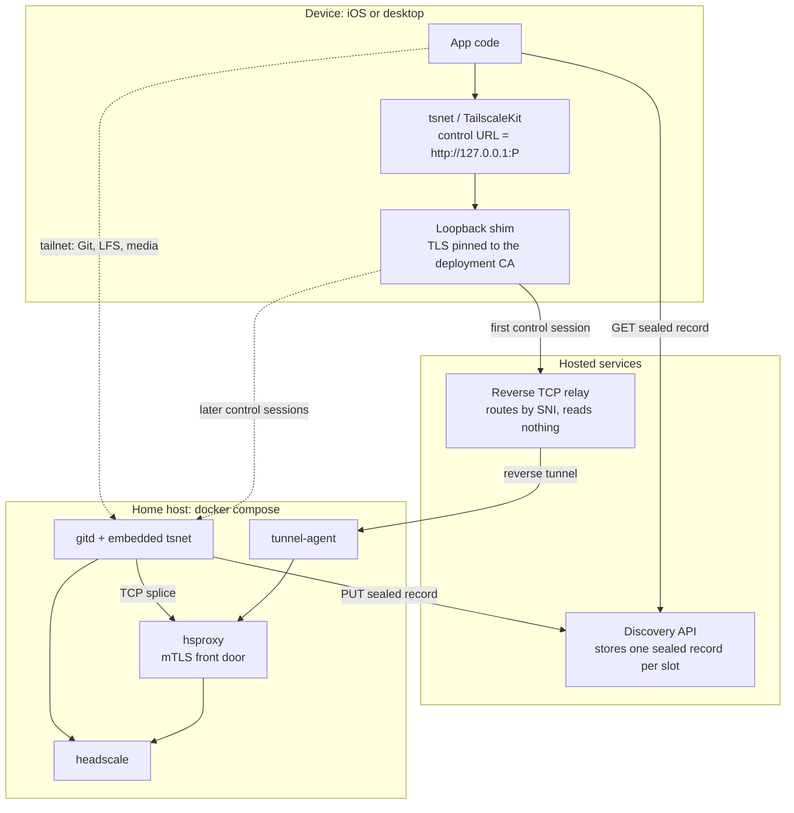

# Connectivity

Devices reach gitd over a private tailnet rather than over a published port on
the user's router. The server hosts its own tailnet control plane (headscale)
next to gitd, and each device joins that tailnet before it speaks Git or LFS.

This exists because the previous model asked every user to make a home server
reachable from the internet. That means port forwarding, dynamic DNS, and a
publicly exposed TLS listener — a setup step most people cannot complete and a
permanent attack surface for those who can.

## Topology



Two paths matter and they are deliberately separate:

- **Control path.** Joining the tailnet requires talking to headscale. The
  first control session of each app launch goes through the hosted relay,
  because a device cannot route to peers until its node is up. After that the
  device's loopback shim prefers gitd's in-tailnet control relay (a raw TCP
  splice to hsproxy) and falls back to the hosted relay if that path fails.
- **Data path.** Git, LFS, decryptd, and transcoded all travel inside the
  tailnet, peer to peer. They never touch the relay.

## The pieces

| Component | Where it runs | Role |
|-----------|---------------|------|
| headscale | home host, no published port | Tailnet control plane |
| hsproxy | home host, the only externally reachable service | Terminates TLS for headscale and authorizes the device |
| tunnel-agent | home host | Holds an outbound connection to the relay so no router port is needed |
| Reverse TCP relay | hosted, one process per shard | Accepts device connections on the public wildcard hostname and splices them to the agent |
| Discovery API | hosted | Holds one short-lived sealed record per slot |
| tsnet in gitd | home host | Puts gitd on the tailnet instead of on a host port |
| tsnet / TailscaleKit in clients | device | Puts the app on the tailnet |
| Loopback shim | device | Adds pinned TLS and the device certificate to headscale traffic |

### hsproxy

headscale has no client-certificate support and no configuration for a private
CA, so it cannot be the thing that authenticates devices. `hsproxy` sits in
front of it: it terminates TLS with a certificate from the deployment CA,
requires a client certificate, and authorizes the presented public key against
the repository's `pubkeys/` directory — the same authorizer gitd uses. Removing
a `.pub` file therefore revokes tailnet access and Git access at once.

`hsproxy` splices raw bytes rather than proxying HTTP. Tailscale's control
protocol upgrades a `POST` into a long-lived bidirectional stream, which no
HTTP-aware proxy layer survives.

Once a device is on the tailnet, later control sessions go to gitd's second
tsnet listener (`:8444`), which splices to this same `hsproxy`. The
certificate therefore carries both the tunnel hostname and
`gitd.replycant.internal`, so either path verifies.

### Who can talk to whom

The tailnet exists so devices can reach this household's server, not so they
can reach each other. headscale loads a file-mode policy that grants
`tag:device` access to `tag:server` on the Git and control ports only. There
is no device-to-device rule and no server-to-device rule, so a compromised
phone cannot enumerate or attack the rest of the household. gitd's own node
is tagged `tag:server` at mint time; every paired device is tagged
`tag:device`.

### The loopback shim

Neither `tsnet` nor `TailscaleKit` lets a caller install a private trust root or
a client certificate for the control URL. So the client points its control URL
at `http://127.0.0.1:P`, where a small local listener re-establishes the
connection to `hsproxy` over TLS with the deployment CA pinned and the device's
identity presented.

The plaintext hop never leaves the device. The listener binds to loopback only,
and Tailscale's control protocol is Noise-encrypted end to end regardless, so
the outer TLS is an authorization gate and defence in depth rather than the only
protection.

### Reverse TCP relay

The relay lets a home server be reachable without a forwarded port.
`tunnel-agent` dials out to the relay's registration listener presenting the
`hsproxy` leaf and the deployment CA, and the relay accepts the registration
only if the SHA-256 of the presented chain root matches the hostname label being
claimed. Possession of the CA key is the whole credential; there is no shared
secret to distribute.

The registration listener presents a self-signed certificate that is not
issued for any shard hostname. Agents pin that certificate rather than
checking `sNN.tunnel.replycant.com` against the public PKI; the pin is what
stops a random TLS endpoint from collecting registrations.

Device traffic arrives on a separate listener. The relay peeks the TLS
ClientHello, reads the SNI, rejects anything that is not a handshake or whose
SNI has no live registration, and then copies bytes into a multiplexed stream to
the agent.

### Discovery API

A device that has never paired has no trust anchor: it does not know the CA, so
nothing it downloads can be checked against a signature it already trusts. The
discovery API therefore stores a record that is sealed twice, addressed by a
slot derived from a secret shown only in the pairing QR code. See
[Device Onboarding](./device-onboarding.md#tailnet-pairing) for the flow and
[the pairing record](#the-pairing-record) below for the format.

## What the hosted services can and cannot see

This is the part worth being precise about, because "we host a relay" sounds
like "we can read your traffic".

| Service | Sees | Does not see |
|---------|------|--------------|
| Reverse TCP relay | Ciphertext, the SNI hostname, connection timing and volume, client IP addresses | Anything inside the TLS session. It holds no key for it: TLS terminates at `hsproxy` on the user's own host |
| Discovery API | An opaque blob and the slot it was published under | The blob contents. The inner layer is encrypted to the device's age key and the outer layer is an AEAD under a key derived from the QR secret, neither of which the API ever receives |
| Tailscale DERP | WireGuard ciphertext, peer public keys, traffic volume | Packet contents |

The relay's SNI hostname is `{ca-label}.s{NN}.tunnel.replycant.com`. The first
label is a truncated hash of the deployment CA and identifies the deployment
without carrying a user identity. The second label is a shard slot taken from
the next byte of the same digest, modulo a permanently fixed 64. Registrations
live in one relay process's memory, so the fleet is sharded by hostname rather
than by shared state. Growing the fleet repoints DNS for some slots and never
changes a deployment's hostname, so no certificate needs reissuing and no
stored `headscale_url` goes stale.

Every reader of the CA fingerprint — the relay's SNI check, and both clients'
pairing-record verification — takes only the leftmost label, so the shard
component changes none of them.

### DERP

Peer-to-peer is the normal case: two devices on the same LAN connect directly,
and NAT traversal handles most of the rest. When direct connection fails,
Tailscale relays through its public DERP mesh
(`https://controlplane.tailscale.com/derpmap/default`).

That means media bytes can pass through infrastructure operated by Tailscale.
They are WireGuard-encrypted end to end, so Tailscale sees ciphertext, peer
public keys, and volume — not content. Replycant's own encryption sits inside
that, so DERP-relayed LFS objects are encrypted twice over.

The embedded DERP server headscale ships is not an option here. It needs
publicly reachable UDP for STUN and an `https://` `server_url` it terminates
itself, and neither survives a reverse TCP relay.

## The pairing record

```json
{
  "headscale_url": "https://<ca-label>.s<NN>.tunnel.replycant.com",
  "ca_pem": "-----BEGIN CERTIFICATE-----\n...",
  "preauth_key": "..."
}
```

gitd's address is not in the record. Every client already uses
`https://gitd.replycant.internal:8443`.

`preauth_key` is minted by gitd per pairing attempt over headscale's API.
headscale generates pre-auth key material server-side and stores only a hash of
it, so a device cannot propose its own key; the credential has to travel the
other way, inside the record.

The record is sealed in two layers, both binding the slot as associated data so
a valid record cannot be relocated:

1. **Inner:** encrypted to the device's age public key. A bystander who
   photographed the QR code cannot read it.
2. **Outer:** AEAD under a key derived from the pairing secret. Someone who
   knows the slot and the device's public key — both of which are effectively
   public — still cannot forge a record and enroll the device into their own
   tailnet.

Records have a 10-minute TTL and are deleted on read, so a stale record cannot
be replayed.

## Choosing manual exposure

Cloud discovery is the default. Manual exposure trades a small amount of setup
for not depending on the hosted relay or discovery API at all.

Choose manual if you already run dynamic DNS or a static address, you want no
third-party service in the join path, or you are running in an environment where
outbound connections to the relay are blocked.

To enable it, set `REPLYCANT_HEADSCALE_URL` to your own DNS name, bind
`hsproxy` publicly with `REPLYCANT_HSPROXY_BIND=0.0.0.0`, forward that port on
your router, and start the stack with `--scale tunnel-agent=0` so the hosted
relay is not used. Clear `REPLYCANT_DISCOVERY_URL` to keep gitd from publishing
records.

The certificate `hsproxy` presents follows `REPLYCANT_HEADSCALE_URL`
automatically, and pairing hands the record back to the authorizing device to
display as a QR code instead of publishing it. Everything else — the tailnet,
the mTLS gate, gitd being unpublished — is identical.

| | Cloud discovery | Manual exposure |
|---|---|---|
| Router configuration | None | One forwarded port |
| DNS | Provided | Yours to run |
| Third parties in the join path | Relay and discovery API | None |
| Pairing record delivery | Hosted discovery API | Second QR code |

## What closing the ports changed

gitd publishes no host port at all. There is no plain-LAN URL to point a client
at any more; every device joins the tailnet first. Same-LAN peers still connect
directly, so LFS and video throughput are unaffected in the common case.

`hsproxy` is the only service with a `ports:` entry, and it binds to `127.0.0.1`
by default — a plain `docker compose up` exposes nothing to the network.

## Related documentation

- [Device Onboarding](./device-onboarding.md) — the pairing flow end to end
- [Server Architecture](./server-architecture.md) — what gitd serves and how
- [Authentication](./authentication.md) — the mTLS identity used at both gates
