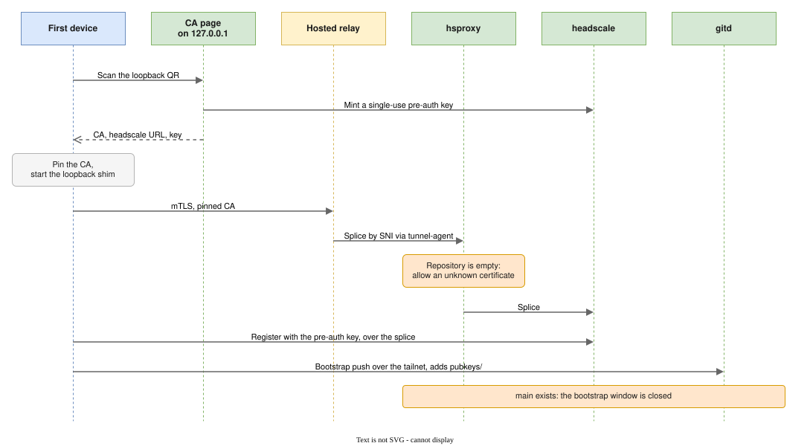
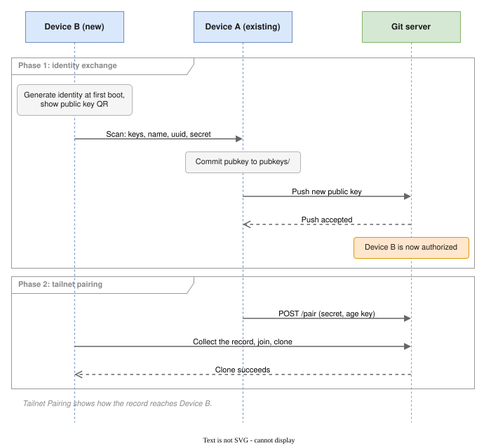
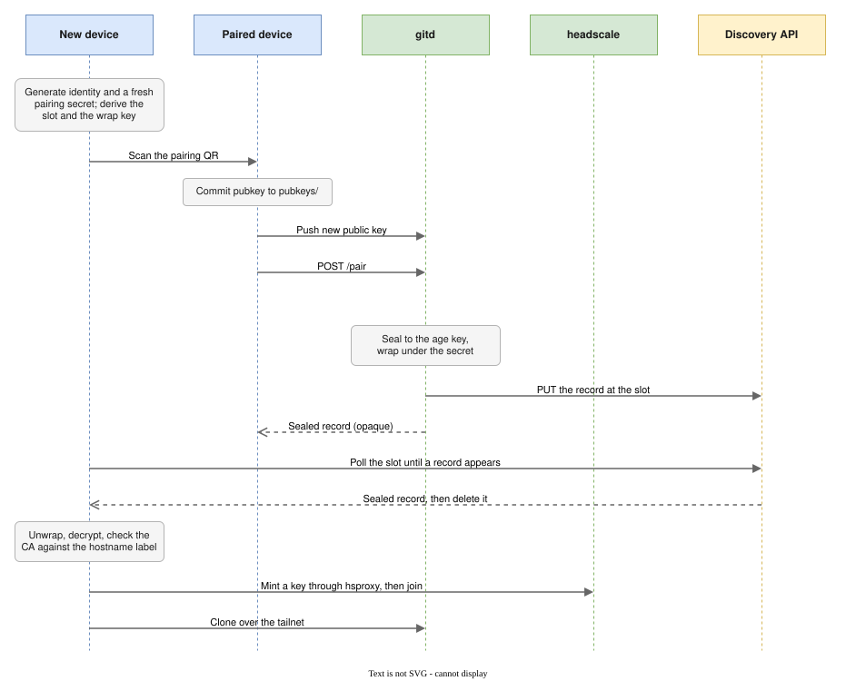

# Device Onboarding

Adding devices to a GitDB repository follows one of two flows: bootstrapping a new repository with the first device, or linking additional devices to an existing repository. Both flows use mTLS authentication with ECDSA P-256 certificates and QR codes to exchange configuration.

## Overview

| Scenario | Description |
|----------|-------------|
| Bootstrap Mode | First device creates repository and establishes access control |
| Device Linking | Existing device authorizes new device via public key exchange |

Both flows result in:
- Device identity (ECDSA P-256 key pair) stored in iOS Keychain
- Public key committed to `pubkeys/` directory in repository
- Device can authenticate via mTLS for all Git operations

## Bootstrap Mode (First Device)

Bootstrap mode allows the first device to push to an empty repository without pre-configured keys. This is how a new GitDB repository is initialized.

### Flow



### Step-by-Step

1. **Open the CA page** at `http://<server>:8080`, either on the machine running gitd or from another machine on the LAN. Set `REPLYCANT_CA_BIND=127.0.0.1` to keep it on the host. The page hands out join keys only while the repository is empty. After that it answers `410 Gone`.
2. **Scan the QR** with the iOS app, the only client that can create a library. The payload is a one-time join: CA, headscale URL, and a preauth key. Clients already know gitd as `https://gitd.replycant.internal:8443`.
3. **Join, then push**: the first device joins the tailnet, creates a local repository, commits its public key to `pubkeys/`, and pushes. The server accepts because the repository is empty.
4. **Access control active**: subsequent connections require a certificate matching a key in `pubkeys/`

While the repository has no branches, `hsproxy` allows the first device's certificate even though it is not in `pubkeys/` yet. That exemption is what makes the join possible: the key cannot be committed until gitd is reachable over the tailnet, and the bootstrap push is what closes the window. [Joining a new repository](./connectivity.md#joining-a-new-repository) walks the whole path.

### Race Condition Prevention

When multiple devices attempt to bootstrap simultaneously, a mutex prevents race conditions:

1. Server detects empty repository (no branches)
2. Server acquires bootstrap mutex lock
3. Authentication re-checked after acquiring lock
4. If repository still empty, push proceeds
5. If another device pushed first, normal authentication applies

This ensures exactly one device can perform the initial bootstrap.

### Security Considerations

| Consideration | Mitigation |
|---------------|------------|
| First push wins | Initialize repositories in controlled environments |
| No pre-authorization | Consider pre-populating `pubkeys/` for production |
| Physical access required | QR code scanning requires camera access to server display |

## Device Linking (Adding to Existing Repository)

When a repository already has authorized devices, new devices must be explicitly authorized by an existing device. Phase 1 is a public-key QR. Phase 2 is [Tailnet Pairing](#tailnet-pairing).

### Flow



### Phase 1: Identity Exchange

1. **Device B generates identity**: At first launch, Device B creates ECDSA P-256 key pair
2. **Device B displays QR**: Shows its public keys, device name, UUID, and a fresh pairing secret as QR code
3. **Device A scans QR**: Reads Device B's public key information
4. **Device A commits key**: Adds `pubkeys/{name}-{uuid}.pub` to repository
5. **Device A pushes**: Server now recognizes Device B's certificate

### Phase 2: Reaching the server

gitd publishes no address Device B can dial, and Device B does not yet know the CA or where the control plane is. [Tailnet Pairing](#tailnet-pairing) delivers both. Device B then joins the tailnet and clones with mTLS; its certificate is already in `pubkeys/` from phase 1.

### Why Two Phases?

The two-phase exchange solves the authorization chicken-and-egg problem:

- Device B cannot clone without being authorized
- Device B cannot be authorized without Device A knowing its public key
- Device A cannot know Device B's key without some exchange mechanism
- QR codes provide a secure, offline exchange channel

## QR Code Formats

### Server Configuration QR

Shown by the CA page for the first device, minted per page load:

```json
{
  "ca": "-----BEGIN CERTIFICATE-----\n...\n-----END CERTIFICATE-----",
  "headscale_url": "https://<ca-label>.s<NN>.tunnel.replycant.com",
  "preauth_key": "hskey-..."
}
```

| Field | Description |
|-------|-------------|
| `ca` | PEM-encoded CA certificate for server validation (pinning) |
| `headscale_url` | Control plane the first device joins |
| `preauth_key` | Single-use tailnet key, minted per request. Only the first device gets one this way; every later device mints its own once its public key is in `pubkeys/` |

There is no server URL in the payload: gitd is always `https://gitd.replycant.internal:8443`, and clients derive the LFS endpoint as `{origin}/lfs`.

### Public Key QR

Displayed by new device during linking:

```json
{
  "pubkey": "ecdsa-sha2-nistp256 AAAAE2VjZHNhLXNoYTItbmlzdHAyNTYAAAAI...",
  "age_pubkey": "age1q...",
  "name": "iphone-15-pro",
  "uuid": "A1B2C3D4-E5F6-7890-ABCD-EF1234567890",
  "pairing_secret": "q3Jx..."
}
```

| Field | Description |
|-------|-------------|
| `pubkey` | SSH-format ECDSA P-256 public key |
| `age_pubkey` | Bech32-encoded age X25519 public key for encryption |
| `name` | Human-readable device name |
| `uuid` | Unique device identifier (prevents name collisions) |
| `pairing_secret` | Base64url secret authenticating the pairing record. Required: the new device cannot reach the server, so the record is its only way in. |

## Tailnet Pairing

A device that is not on the server's network cannot discover anything: gitd
publishes no port, and the device does not know the CA or where the control
plane is. Tailnet pairing solves that by having an already-paired device ask
gitd to publish both where the new device can collect them. The record holds
no tailnet key: the new device is in `pubkeys/` by then, so it mints its own
through hsproxy. See [Connectivity](./connectivity.md) for the transport this
sets up.

### Flow



### Step-by-step

1. **New device mints a pairing secret.** 32 random bytes, generated per
   attempt, held in memory and never persisted. Two values are derived from it
   with domain separation: the discovery slot that addresses the record, and the
   wrap key that authenticates it.
2. **New device shows its QR**, including `pairing_secret`.
3. **Paired device commits and pushes** the new public key, exactly as in normal
   device linking.
4. **Paired device calls `POST /pair`** on gitd with the secret from the QR.
   Only a device already in `pubkeys/` can reach this endpoint, because it is
   behind the same mTLS gate as everything else. The age key from the QR was
   committed in step 3, so later epoch wraps include this device.
5. **gitd builds the record** from the CA and the control-plane hostname,
   seals it, and publishes it at the slot. The request is held open until the
   record is stored, so a downstream failure surfaces as an error rather than
   as an unexplained timeout on the other device.
6. **New device polls its slot** until the record appears. The API deletes it on
   read, and it expires after 10 minutes regardless.
7. **New device opens the record** under the pairing secret. A record that
   does not open was not written by the device that scanned this QR.
8. **New device mints a tailnet key** through hsproxy, presenting its device
   certificate, which step 3 already put in `pubkeys/`. It joins the tailnet
   with that key and clones gitd at its MagicDNS name.

### Why the secret is needed

The new device holds no trust anchor: it does not know the CA, so nothing in the
record can be checked against a signature it already trusts. Meanwhile the slot
travels in the clear as a DNS hostname.

The record holds no secret, so confidentiality is not the property it needs.
Authenticity is. The AEAD under the pairing secret is what stops anyone who
can see the slot from planting a record and enrolling the device into their
own tailnet, because the secret only ever appeared on a screen in front of
the user. The slot is bound as associated data, so a valid record cannot be
relocated to a different slot.

## Desktop Onboarding

The desktop app links like any second device: it shows the public-key QR,
an iOS device scans it, and the record arrives through
[Tailnet Pairing](#tailnet-pairing). It never creates a library, so it never
uses the CA page. The browser build has no tailnet node and shows a
"desktop app required" screen instead of onboarding.

## Recovery Onboarding Path

When all existing device keys are lost, onboarding supports a recovery path that
starts from a recovery bundle instead of a pairing QR from another device.

### Recovery entry points

- Onboarding: **Connect to an existing library**, then scan the recovery QR
  (or paste backup text)
- Deep link: `replycant://recover?v=1&d=...`
  (`&keep=1` skips the post-recovery revoke prompt so the same key can
  be reused; `&pw=` starts recovery without a password prompt. Both
  are for automated testing and App Review only: `pw` collapses the
  two-channel split of key and password. Neither changes
  authentication or crypto.)

### Recovery sequence

1. User provides/scans recovery bundle and enters bundle password.
2. App decrypts bundle and learns the deployment's CA from `headscale_url`,
   accepting it only if its hash matches the pinned `ca_sha256`. The CA page
   closes once the library exists and gitd is tailnet-only, so hsproxy is the
   only reachable endpoint. The app joins the tailnet as the recovery
   identity, which hsproxy authorizes like any device. hsproxy sends the CA
   after its leaf, and the app takes the CA from that chain.
3. App authenticates once with temporary recovery identity.
4. App clones repository, registers a new normal device key, and re-wraps KEK
   epochs for the new device age key.
5. App switches back to normal device identity and deletes temporary recovery
   identity artifacts. It rejoins the tailnet as the device, because hsproxy
   checks the identity on every control connection and the recovery key is
   usually revoked next.

Recovery is rejected if the app is already configured locally; users must
reinstall first to avoid mixing recovery with an existing identity context.

## Key Cache Behavior

An authorized device connects on its first attempt after the pubkey push lands on `main`. A removed key stops working just as promptly. The server reloads authorized keys whenever `main` moves, so enrollment and revocation do not wait on a cache timer.

## Security Properties

| Property | Bootstrap Mode | Device Linking |
|----------|----------------|----------------|
| Authorization | First push wins | Explicit by existing device |
| Key exchange | Via CA page QR | Pubkey QR, then tailnet pairing |
| Audit trail | Git history of pubkeys/ | Git history of pubkeys/ |
| Revocation | Remove key from pubkeys/ | Remove key from pubkeys/ |

## Related Documentation

- [Authentication](./authentication.md) - mTLS protocol and certificate details
- [Connectivity](./connectivity.md) - the tailnet transport pairing sets up
- [Server Architecture](./server-architecture.md) - Server-side bootstrap mode implementation
- [Device Identity](../replycant-ios/device-identity.md) - Immutable identity lifecycle
