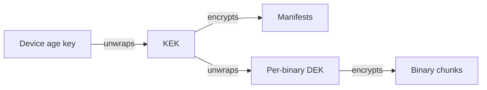

# Encryption

GitDB treats the server as untrusted storage. Every manifest and binary is
encrypted on the client before it leaves the device, so a server compromise
exposes only opaque blobs. [mTLS](./authentication.md) protects data in
transit; the encryption described here protects it at rest.

## How the keys fit together

Three layers of keys protect the data:

1. Each device has an **age key** (X25519). It unwraps the library's KEK.
2. The **KEK** (key encryption key) is a random AES-256 key. It encrypts
   manifests directly and wraps the per-binary DEKs.
3. Each binary has its own **DEK** (data encryption key), also AES-256. It
   encrypts that one binary.



Any device whose age public key is in a key set under `pubkeys/` can decrypt everything.
Adding a device only re-wraps the small KEK file, and revoking one only
creates a new KEK. Neither touches the encrypted objects.

Each device holds two key pairs, both stored in the iOS Keychain or, on
desktop, in encrypted localStorage (protected by the OS keyring or a
password):

| Key | Algorithm | Used for |
|-----|-----------|----------|
| Identity key | ECDSA P-256 | [mTLS authentication](./authentication.md) |
| Encryption key | age (X25519) | Unwrapping the KEK |

Both public keys live in one plaintext file per key holder:

```text
pubkeys/
  iphone-16e.yaml
  kitchen-ipad-<uuid>.yaml
```

```yaml
apiVersion: gitdb.replycant.com/v1alpha1
kind: KeySet
metadata:
  name: iphone-16e          # must equal the file name
spec:
  type: device              # device or recovery
  mtlsPublicKey: ecdsa-sha2-nistp256 AAAA...
  agePublicKey: age1...
  displayName:              # optional; only a device with the KEK can read it
    kekEpoch: 2
    ciphertext: <base64 nonce || ciphertext || tag>
```

The file is plaintext because gitd authorizes a device before any of them
has unwrapped the KEK. `displayName` is the exception: it is AES-256-GCM
sealed with the KEK for `kekEpoch`, and the additional data is
`replycant-keyset-display-name-v1` followed by `metadata.name`. That
binding means a rewritten file cannot move a name onto another key set.
When the field is missing, or this device cannot open it, readers show
`metadata.name`. Key sets stay outside `manifests/` so that directory can
stay uniformly encrypted. See [Manifests](./manifests.md).

[age](https://github.com/FiloSottile/age) is used instead of GPG or ECIES
with P-256 because it has no configuration, key servers, or web of trust,
and a public key is one ~62-character string. It is also small enough to
implement natively with Apple CryptoKit (Curve25519 and ChaCha20-Poly1305)
and the `age-encryption` npm package, without shelling out to a CLI.

## Key epochs

The KEK is a random 32-byte key, stored in the repository encrypted with age
for every authorized device. Each KEK is an epoch:

```text
gitdb/
  version              # database format version, for example "2"
encryption/
  current              # active epoch number, for example "2"
  epochs/
    1.age              # KEK epoch 1, age-encrypted for all recipients
    2.age              # KEK epoch 2, after a key rotation
```

`gitdb/version` pins the repository layout and crypto handling, and clients
refuse any other value. See [Database format version](./database-version.md).
Manifest schemas are versioned separately, by each resource's `apiVersion`.

The first device creates epoch 1 for its own age key. After that, epochs
change only when devices come and go:

| Event | Action |
|-------|--------|
| Device added | Re-wrap every epoch file for the new age key |
| Device removed | New KEK for the remaining devices; bump `current` |
| Key rotation | Same as device removal |

New objects always use the current epoch. A removed device keeps the old
KEKs from Git history and can still read old objects, but it cannot read
anything added afterwards. Adding a device re-wraps every epoch, so the new
device can read the whole history. The app flows for these events are in
[Device onboarding](./device-onboarding.md).

## Manifests

Manifests are encrypted directly with the current KEK using AES-256-GCM.
They are small and numerous and never shared one at a time, so a
per-manifest DEK would add cost without benefit.

The encrypted file keeps its `.yaml` name and
[path](./manifests.md), but its content becomes:

```text
REPLYCANT-ENC-V1
kek-epoch: 2
---
<12-byte nonce><ciphertext><16-byte GCM tag>
```

The plaintext is the original YAML, the nonce is random per file, and
`kek-epoch` names the KEK to decrypt with.

Clients fail closed. They reject any manifest without the `REPLYCANT-ENC-V1`
envelope and any LFS pointer without `x-replycant-*` metadata. There is no
plaintext fallback, so a hostile server that strips encryption cannot make
clients parse attacker-controlled data.

For development, a Git clean/smudge filter encrypts on commit and decrypts on
checkout, so standard Git tooling works. Smudge rejects plaintext repository
objects. The one exception is `textconv` (path-argument smudge), which shows
already-decrypted worktree files in `git diff` and never writes back.

## Binaries

Each binary gets a random DEK. The binary is split into fixed-size chunks,
each encrypted and authenticated with AES-256-GCM, and the wrapped DEK goes
into the [LFS pointer](#lfs-pointer).

### Why each binary has its own key

- **Blast radius**: a leaked DEK exposes one file, not the library.
- **Nonce safety**: chunk nonces come from the chunk index. Each DEK
  encrypts one file, so no key and nonce pair is ever reused.
- **Sharing**: a single DEK can grant access to one object without exposing
  the KEK.
- **Rotation**: rotating the KEK never re-encrypts binaries.

DEKs are random rather than derived from the content. Convergent encryption
would let the LFS server deduplicate identical files, but clients never
upload the same binary twice: they deduplicate by plaintext SHA-256 before
any upload. Random keys are the safer choice and lose nothing.

### Chunk format

The encrypted binary on the LFS server is a headerless sequence of chunks:

```text
[chunk 0: ciphertext | 16-byte GCM tag]
[chunk 1: ciphertext | 16-byte GCM tag]
...
[chunk N-1: ciphertext | 16-byte GCM tag]
```

Nonces are derived, never stored. Each chunk is sealed with:

- **nonce**: `0x00000000 || uint64BE(index)`
- **AAD**: `"replycant-lfs-chunk-v1" || uint64BE(index) || uint8(isLast)`

Binding the index and the last-chunk flag into the AAD means tampering,
reordering, and truncation all fail authentication. Wrapped DEKs use the AAD
`"replycant-dek-wrap-v1" || uint64BE(kekEpoch)`.

| Property | Value |
|----------|-------|
| Chunk size | 64 KiB (65,536 bytes) of plaintext |
| Per-chunk overhead | 16 bytes (GCM tag) |
| Overhead for a 1 GB file | ~256 KB (~0.025%) |

Chunk size is a compile-time constant, not pointer metadata. The last chunk
may be shorter, and empty plaintext produces zero chunks. Chunked GCM was
chosen over single-block or CTR mode because it gives both per-chunk
authentication and random access.

### LFS pointer

The standard LFS pointer carries two extra fields:

```text
version https://git-lfs.github.com/spec/v1
oid sha256:4d7a2146...
size 4821033
x-replycant-kek-epoch 2
x-replycant-wrapped-dek <base64>
```

| Field | Meaning |
|-------|---------|
| `oid` / `size` | SHA-256 and size of the **encrypted** content |
| `x-replycant-kek-epoch` | KEK epoch that wrapped the DEK |
| `x-replycant-wrapped-dek` | The DEK, wrapped with the KEK |

The DEK lives in the pointer rather than the manifest because the pointer
already owns retrieval, so it owns decryption too. The
[manifest's `sha256`](./media-storage.md) stays the hash of the
**plaintext**, for verification after decryption.

### Reading a binary

1. Read `x-replycant-kek-epoch` and `x-replycant-wrapped-dek` from the LFS
   pointer.
2. Unwrap the KEK for that epoch with the device's age private key.
3. Unwrap the DEK with the KEK and the epoch-bound AAD.
4. Download the chunks you need from LFS.
5. Decrypt each chunk with the DEK, deriving its nonce and AAD from the
   chunk index and last-chunk flag.
6. Concatenate the plaintext. For a whole file, verify its SHA-256 against
   the manifest's `sha256`.

Video transcoding and HLS streaming read byte ranges without decrypting the
whole file. To read N bytes at offset O, fetch chunks
`O / 65536` through `(O + N - 1) / 65536`. Each encrypted chunk is
`65536 + 16` bytes, so the range starts at `start_chunk * 65552`, and HTTP
range requests fetch only those chunks. At worst, reading one byte decrypts
one 64 KiB chunk.

## Recovery keys

Recovery keys are an emergency path for when every normal device key is
lost. They are the same key set as a device, with `spec.type: recovery`,
and they live in the same `pubkeys/` directory:

```text
pubkeys/
  my-phone-<uuid>.yaml
  home-safe-<uuid>.yaml
```

The recovery file's `mtlsPublicKey` is a P-256 SSH-form public key, so
gitd authorizes it with the same matching logic as a device. Settings
lists it with the recovery keys, not with the devices.

### Bundle format

The private halves are exported as an encrypted JSON envelope:

- KDF: `PBKDF2-HMAC-SHA256`, 600k iterations
- Cipher: `AES-256-GCM`
- Plaintext: the recovery P-256 PEM key, the recovery age private key, the
  pinned CA SHA-256 hash, and the deployment's `headscale_url`

The app exports the envelope as a QR code containing the raw JSON, or as a
deep link `replycant://recover?v=1&d=<base64url envelope>`. Neither needs a
hosted web domain.

Recovery runs only on a fresh install. The app decrypts the bundle, joins
the library with the recovery identity, re-wraps the KEK epochs for a new
device age key, and then switches to that new device identity. See
[Recovery onboarding path](./device-onboarding.md#recovery-onboarding-path)
for the full flow and the optional deep link parameters.

### Manual recovery

If the app cannot run recovery, you can process the bundle by hand:

1. Decode the envelope JSON from the QR code or from the deep link's `d`
   parameter.
2. Derive the AES key with the bundle's KDF parameters
   (`PBKDF2-HMAC-SHA256`).
3. Decrypt the envelope ciphertext (`AES-256-GCM`) to get the plaintext JSON.
4. Connect to `headscale_url`, take the CA from the certificate chain hsproxy
   presents, and check that its hash matches `ca_sha256`.
5. Use `p256_private_key` for temporary mTLS Git access.
6. Use `age_private_key` to re-wrap the KEK epoch files and add a new device
   key pair in `pubkeys/`.

This is why the bundle is plain JSON and carries both private keys.
