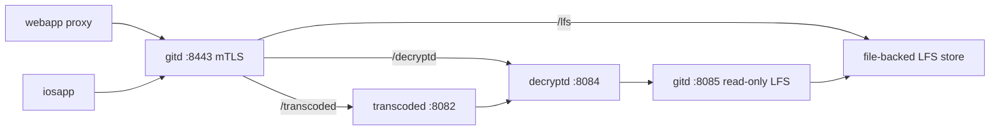

# Server Architecture

gitd is a Go-based Git server that provides authenticated access to repositories using mTLS with P-256 ECDSA certificates. It wraps `git-http-backend` for Git protocol handling, serves a native file-backed Git LFS API, and acts as the single authenticated entrypoint for media backends.

## Overview

gitd runs three HTTP servers. The Git listener is on the tailnet only, at
`gitd.replycant.internal:8443`. The CA listener defaults to 8080
(`--ca-addr`) and is the only one compose publishes.

| Server | Default port | Protocol | Purpose |
|--------|--------------|----------|---------|
| Git Server | 8443 | HTTPS (mTLS) | Git Smart HTTP, native `/lfs`, `/pair`, media proxies |
| CA Server | 8080 | HTTP | Certificate distribution for device onboarding |
| Internal LFS | 8085 | HTTP | Read-only LFS for compose-network services |

**gitd publishes only the CA page**, on port 8080 (every interface unless
`REPLYCANT_CA_BIND` narrows it). The Git listener is
bound to an embedded `tsnet` node, so gitd is reachable only from inside the
deployment's tailnet, at `https://gitd.replycant.internal:8443`. `hsproxy` is
the other published port, and it binds to loopback unless the deployment is in
manual-exposure mode. See [Connectivity](./connectivity.md) for the whole
topology.

Media backends sit on the internal Docker network:

| Route | Implementation | Purpose |
|-------|----------------|---------|
| `/lfs` | in-process LFS store (`--lfs-dir`) | Git LFS object storage |
| `/pair` | discovery client | Seals a pairing record (CA and control-plane hostname) for a device being onboarded |
| `/decryptd` | reverse proxy to decryptd (`:8084`) | On-the-fly decryption of LFS objects |
| `/transcoded` | reverse proxy to transcoded (`:8082`) | HLS transcoding for video playback |



Because decryptd and transcoded serve plaintext media derived from the encrypted
library and perform no authentication of their own, putting them behind gitd is
what keeps decrypted photos and video unreachable without a device certificate.
See [ADR-0007](https://github.com/mr-andreas/replycant/blob/main/server/adr/0007-gitd-media-service-proxy.md).

```
┌─────────────────────────────────────────────────────────┐
│                         gitd                            │
├─────────────────────────┬───────────────────────────────┤
│     Git Server (:8443)  │      CA Server (:8080)        │
│                         │                               │
│  ┌──────────────────┐   │   ┌───────────────────────┐   │
│  │  TLS 1.3 + mTLS  │   │   │  QR Code Generation   │   │
│  └────────┬─────────┘   │   └───────────────────────┘   │
│           │             │                               │
│  ┌────────▼─────────┐   │   ┌───────────────────────┐   │
│  │  Authentication  │   │   │  Certificate Display  │   │
│  └────────┬─────────┘   │   └───────────────────────┘   │
│           │             │                               │
│  ┌────────▼─────────┐   │                               │
│  │ git-http-backend │   │                               │
│  └──────────────────┘   │                               │
└─────────────────────────┴───────────────────────────────┘
```

## Git Server

The Git server handles all Git Smart HTTP operations with mTLS authentication.

### Requirements

- **TLS 1.3**: Minimum TLS version enforced for all connections
- **Client Certificate**: Every request must include a valid P-256 ECDSA certificate
- **Bare Repository**: The target repository must be a bare Git repository

### Request Flow

1. Client initiates TLS connection with client certificate
2. Server extracts P-256 public key from certificate
3. Server validates key against authorized keys in `pubkeys/` directory
4. If authorized and the path is under `/lfs`, the native LFS handler serves batch/upload/download from the file-backed store
5. If authorized and the path is `/pair`, gitd seals a pairing record and publishes it to the discovery API
6. If authorized and the path matches `/decryptd/*` or `/transcoded/*`, the prefix is stripped and the request is proxied to that upstream, with server-side Basic auth injected when the configured upstream URL carries credentials
7. Otherwise, request is proxied to `git-http-backend` via CGI
8. On push (`git-receive-pack`), Git runs the `pre-receive` hook to verify referenced LFS objects exist on disk
9. If validation succeeds, refs are updated; otherwise the push is rejected atomically

### CGI Environment

The server passes these environment variables to `git-http-backend`:

| Variable | Description |
|----------|-------------|
| `GIT_PROJECT_ROOT` | Path to the bare repository |
| `GIT_HTTP_EXPORT_ALL` | Set to `1` to allow access without `git-daemon-export-ok` |
| `REMOTE_USER` | Authenticated username (from pubkey filename) |
| `REPLYCANT_LFS_DIR` | On-disk LFS store root used by the pre-receive validator |

## CA Certificate Distribution

The CA server provides a simple way for devices to obtain the server's CA certificate and connection details.

### Endpoints

| Endpoint | Content-Type | Description |
|----------|--------------|-------------|
| `/` | `text/html` | HTML page with QR code and copyable text |
| `/qr.png` | `image/png` | QR code image for scanning |
| `/config.json` | `application/json` | Machine-readable copy of the QR payload, for tooling and the integration suites (same-origin only) |

### QR Code Data

The QR code contains JSON with all information needed to configure a client:

Each request mints a one-time join:

```json
{
  "ca": "-----BEGIN CERTIFICATE-----\n...\n-----END CERTIFICATE-----",
  "headscale_url": "https://<ca-label>.s<NN>.tunnel.replycant.com",
  "preauth_key": "hskey-..."
}
```

Clients always reach gitd at `https://gitd.replycant.internal:8443` once they
are on the tailnet; that address is not carried in the QR.

The `/config.json` endpoint returns the same payload as the QR JSON. It sends
no CORS headers: the payload carries a live join key, so no other website may
read it.

### Device Onboarding

1. Open `http://127.0.0.1:8080` on the host running gitd
2. Scan the QR with the iOS app, which creates the library
3. The first device joins the tailnet, then pushes to gitd over it

## Key Caching

Authorized keys from the `pubkeys/` directory are cached to minimize tree walks and blob parses. The cache is keyed on the `main` commit hash, so a push that adds or removes a `.pub` file is picked up on the next request.

### Cache Behavior

- **Cache key**: the `main` commit hash. Any push that changes `pubkeys/` reloads the authorized set on the next request.
- **Refresh bound**: `--cache-ttl` (default 5 minutes) only limits cache age while `main` has not moved.
- **Enrollment and revocation**: both take effect on the next request after the push.

A deleted `.pub` never fails authentication against a stale cache, so revocation cannot wait on a failed-auth retry. Reloading when `main` moves is what makes revocation immediate.

## Bootstrap Mode

Bootstrap mode allows the first push to an empty repository without requiring pre-configured keys.

### Race Condition Prevention

When multiple clients attempt to bootstrap simultaneously, a mutex prevents race conditions:

1. Authentication detects empty repository (no branches)
2. Server acquires bootstrap mutex lock
3. Authentication is re-checked after acquiring lock
4. If repository is still empty, push proceeds
5. If another client pushed first, normal authentication applies

This ensures only one client can perform the initial bootstrap, and subsequent clients must be authorized by the keys in the first push.

### Security Considerations

- Bootstrap mode only activates for repositories with **no branches at all**
- The first user to push gains control by adding their key to `pubkeys/`
- Repository administrators should initialize repositories in controlled environments
- For production use, consider pre-initializing repositories with authorized keys

## CLI Usage

```bash
gitd \
  --repo /path/to/bare/repo.git \
  --cert /path/to/server.crt \
  --key /path/to/server.key \
  --ca /path/to/ca.crt \
  --lfs-dir /var/lib/replycant/lfs \
  --decryptd-url http://decryptd:8084 \
  --transcoded-url http://transcoded:8082 \
  --tsnet-dir /data/tsnet \
  --tsnet-control-url http://headscale:8080 \
  --headscale-api-url http://headscale:8080 \
  --headscale-api-key-file /data/tailnet/headscale.apikey \
  --headscale-client-url https://<ca-label>.s<NN>.tunnel.replycant.com \
  --tailnet-reconcile-marker /data/gitd/tailnet-reconcile.json \
  --discovery-url https://discovery.replycant.com
```

| Flag | Required | Default | Description |
|------|----------|---------|-------------|
| `--repo` | Yes | - | Path to bare Git repository |
| `--cert` | Yes | - | Server TLS certificate |
| `--key` | Yes | - | Server TLS private key |
| `--ca` | Yes | - | CA certificate for client trust |
| `--lfs-dir` | Yes | - | Directory for the native file-backed LFS object store |
| `--lfs-internal-addr` | No | `:8085` | Read-only internal LFS listen address (empty disables) |
| `--decryptd-url` | Yes | - | Internal upstream decryptd URL proxied at `/decryptd` |
| `--transcoded-url` | Yes | - | Internal upstream transcoded URL proxied at `/transcoded` |
| `--ca-addr` | No | `:8080` | CA distribution listen address |
| `--cache-ttl` | No | `5m` | Key cache TTL |

### Tailnet flags

gitd serves Git only on the tailnet, as `gitd.replycant.internal:8443`; it has
no host-port listener.

| Flag | Required | Default | Description |
|------|----------|---------|-------------|
| `--tsnet-dir` | Yes | - | Tailnet node state directory |
| `--tsnet-control-url` | Yes | - | headscale control URL as seen from the compose network |
| `--tailnet-control-upstream` | No | `hsproxy:8443` | hsproxy address that control-plane traffic arriving over the tailnet is spliced to |
| `--headscale-api-url` | Yes | - | headscale API base URL, used to mint gitd's own tailnet key and the first device's key, and to remove device nodes on revocation |
| `--headscale-api-key-file` | Yes | - | File holding the headscale API key, re-read on every call so a key replaced after a database wipe takes effect |
| `--headscale-client-url` | Yes | - | headscale URL advertised to pairing devices: the tunnel hostname, or your own DNS name in manual mode |
| `--tailnet-reconcile-marker` | Yes | - | Writable file recording the `pubkeys/` set last reconciled with headscale and the key each device node uses. Losing it makes every device rejoin once |
| `--headscale-user` | No | `replycant` | headscale user that paired devices register under |
| `--discovery-url` | No | - | Discovery API base URL, with the slot prepended as a subdomain. Unset selects manual-exposure delivery |

`--discovery-url` is the one optional pairing flag: its presence is what
chooses between publishing the sealed record to the hosted API and handing it
back for the authorizing device to display as a QR code.

## Webapp Proxy mTLS Bridging

The Replycant webapp no longer runs a standalone proxy listener in normal
development. Instead, the shared Express API app is mounted inside the active
host:

- Vite development middleware for browser-based webapp development
- Electron desktop server for packaged desktop runtime
- `desktop:dev` still serves the UI from Vite, but proxies `/api` through
  Electron so the tailnet SOCKS pool is used

`--git-base-url` and CA certificate flags remain optional for onboarding. The
API app can boot unconfigured and receive runtime setup from the renderer
through `POST /api/setup/configure` once the pairing record has arrived. The
webapp proxy derives every runtime service base
from the git origin: `{origin(gitBaseUrl)}/lfs`, `/decryptd`, and `/transcoded`.

For browser clients, the proxy accepts per-request client key and client certificate headers on `/api/git/*`, `/api/lfs/*`, `/api/decryptd/*`, and `/api/transcoded/*`, uses browser-provided CA material for upstream TLS, and uses those headers to establish upstream mTLS. This keeps long-term key storage and trust bootstrap in the browser while avoiding persisted client private keys on the proxy host.

Direct-play video is the one path that cannot send those headers, because a
`<video>` element issues the request itself. For that case the browser registers
its identity once through `POST /api/setup/session` and the proxy holds it in
memory against an `httpOnly` session cookie. See
[webapp ADR-0011](https://github.com/mr-andreas/replycant/blob/main/webapp/adr/0011-session-scoped-mtls-material.md).
