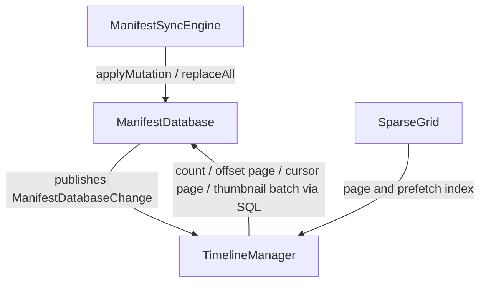

# SQLite Manifest Cache

Replycant iOS persists manifests in SQLite (via GRDB) through GitDB so timeline and manifest reads are local, deterministic, and fast across app launches.

## Components

- `ManifestDatabase`: stores registered manifest kinds in `manifests_{kind}` tables plus sync metadata.
- `ManifestSyncEngine`: syncs git commit transitions into database mutations.
- `ManifestRegistry`: app registers manifest kinds, extracted SQL columns, and indexes.
- `DefaultManifestManager`: runs app SQL queries through GitDB's generic query API.
- `TimelineManager`: supplies timeline pages and thumbnail bytes, and applies manifest changes onto the sparse grid.

## Data Flow

## Sparse Timeline Loading

The contiguous item window, the viewport prefetch range, and the collection view live in the SparseGrid package. `TimelineManager` supplies pages, loads thumbnail bytes, and still applies manifest changes.

- Timeline length is based on `countTimelineOriginals`.
- Grid cells are indexed by `0..<totalCount`.
- SparseGrid keeps one contiguous loaded window: a global offset plus the items in that run.
- A cell near either edge extends the window by one page. A jump farther away replaces it. An empty neighbor page leaves the window where it is.
- The prefetch range is the visible indices plus a margin before and after them. SparseGrid asks `TimelineManager` to load or cancel each id. The manager skips a thumbnail that is already cached or already loading.
- `TimelineManager` turns each requested page into timeline items, including the thumbnail batch from `loadThumbnailsByOriginalRefs`.
- Manifest inserts and deletes edit that same window in place.

## Reactive Change Publishing

After every write, `ManifestDatabase` emits:

- `.incremental(ManifestMutation)` for surgical updates.
- `.fullReplace` for full cache rebuild/reset.

`ManifestMutation` includes:

- `added: [any Manifest]`
- `removed: [(kind: String, id: String)]`

This lets `TimelineManager` rebuild sparse state deterministically while app-specific projections remain query-driven.

## Cache Lifecycle

The shared sqlite file stays open for the process lifetime. Reset and wipe paths follow one invariant so GRDB never reads a deleted vnode:

- Index rebuilds (`hydrateIndex(resetDatabase:)`) truncate tables in place and keep the live connection.
- Full wipes close the GRDB queue before unlinking the file.
- Every holder of the shared database, including `GitDBManager`, rebinds when `ManifestLoaderManager` broadcasts invalidation.

## Schema version

The cache is disposable: git can rebuild it. `ManifestRegistry.schemaVersion` is stored in SQLite's `user_version`. Opening a file with any other value erases it in place. The erase clears the synced commit, and the next launch hydrates the index from the local repository, showing the same progress as the first index build.

Bump the version when registered columns, indexes, or the base table layout change. It is separate from `cacheFormatVersion`, which tracks the repository's `gitdb/version`.

## Places map

Original manifests project nullable `latitude` and `longitude`, indexed where a coordinate exists. Timeline reads take a scope:

- the whole library, which is every original with `takenAt`
- geotagged originals, for the map
- one lat/lon box, for the place a map tile opened

The map reads `id`, `latitude`, `longitude`, and `takenAt` without decoding manifest JSON, and clusters those points on device. A tile's box is the scope of the timeline grid it opens, so the grid, the month sidebar, and the viewer all stay inside that place. The place title comes from reverse geocoding the cluster center.
